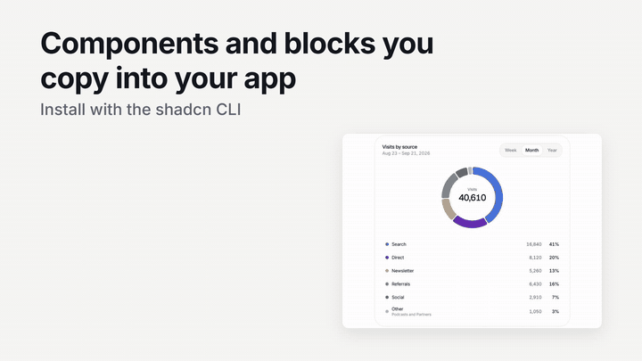
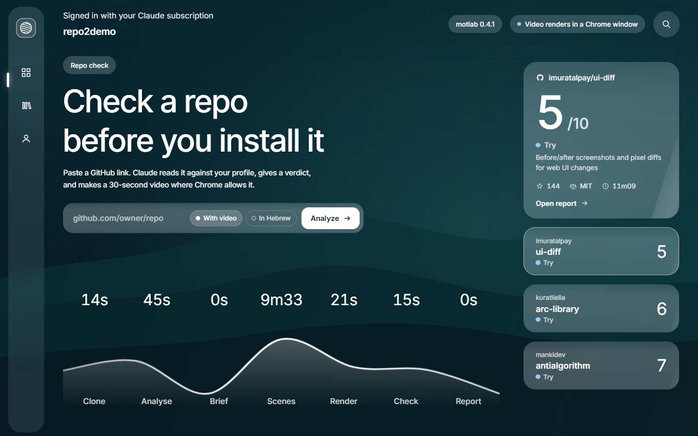

<div align="center">

# repo2demo

### Is this AI repo worth *your* time? Find out before you install it.

Paste a GitHub link. Claude reads the repo against **your** profile, gives a verdict with evidence,<br>
and makes a 30-second demo video, including a short example of how you would actually use it.



**[▶ Watch a full example video (39 s)](docs/demo.mp4)** · [Contact sheet](docs/demo-sheet.jpg)

</div>

---

## Why

Every week brings a flood of new AI repos: agent frameworks, Claude Code skills and plugins, MCP servers, "10x"
tools. The READMEs all promise a lot. Very few tell you the only thing that matters:

> **Does this fit what *I* build, the way *I* work, the data *I'm* allowed to use, and the machines *I* have?**

Starring everything and trying a few at random does not scale. repo2demo turns each repo into a short, honest answer
written for you, so you can pick skills and agents deliberately, and only adopt the ones that pay off.

## Where the idea came from

It started with a collection site: one place where strong repos from all kinds of sources get gathered, so you can go
through them later, in your own time. The collection kept growing faster than anyone could actually try things, and
"later" became a long list of links nobody opened.

repo2demo is the missing second half of that workflow. Collect freely; then, when you have time, run each link through
repo2demo and get a verdict, an example and a 30-second video, instead of a tab you never come back to. The library
keeps the result, so the pile turns into decisions: what to adopt, what to watch, and what to drop.

## What you get for every repo

| | |
|---|---|
| **A verdict** | `use` · `try` · `watch` · `skip`, with a fit score out of 10 and a 2-3 sentence summary |
| **Concrete uses** | What it would do for you, your team, the people you build for, or your presentations, each tagged with effort and whether it is OK for sensitive data |
| **An example** | One practical use, in steps: what you type, what happens, what comes out. Built from the repo's docs, never by running it |
| **Can you use it?** | Work vs home, sensitive vs non-sensitive data, licence and install constraints |
| **Risks and evidence** | What to watch out for, and every key claim linked to the file it came from |
| **A demo video** | 30-40 s, 1080p, one clean style for every repo, with the example animated. A `skip` gets no video, just a clear "why not" |
| **A library** | Everything you checked, searchable and filterable by verdict. Re-run or delete any of it |

<p align="center"></p>

## The profile is the point

repo2demo judges every repo against one file you write once: `config/profile.local.md` (git-ignored, it never leaves
your machine). Start from [`config/profile.example.md`](config/profile.example.md):

- **Role:** what you build, for whom, whether you lead a team, how you present your work.
- **Data sensitivity:** where sensitive data may go (approved platforms only) and where anything goes.
- **Stack:** the tools, agents and skills you already use, so duplicates get a `skip`.
- **Constraints:** locked-down machines, licence rules, operating system.
- **What "useful" means:** time saved, a new capability, a reusable pattern, something easier to show.

The more concrete the profile, the sharper the verdicts.

## Quick start

```powershell
npm install -g @motlab/cli
npx @motlab/cli setup
copy config\profile.example.md config\profile.local.md   # then describe yourself in it
node server.mjs                                          # UI at http://127.0.0.1:4180
```

Or from the command line:

```powershell
node bin/repo2demo.mjs https://github.com/owner/repo
```

It runs on your own Claude subscription, through the Claude Code CLI signed in on your machine. A report alone takes
about a minute; with the video, about 10.

### Options

```
--lang he        report and video text in Hebrew (RTL)
--no-video       report only
--4k             render 3840x2160
--model <alias>  e.g. opus, sonnet (default: your Claude Code default)
--force          run again even if this repo was already checked
```

## How it works

```
GitHub URL
  → shallow clone, agent config stripped, nothing installed or run
  → Claude (read-only: Read, Glob, Grep) judges it against your profile → structured JSON
  → report.md  +  video brief (exact text, the example, real images from the repo)
  → Claude builds the motlab scenes and checks its own stills
  → render to MP4  → automatic check (length, size, flashes)  → your library
```

- **Safe by default.** The clone is shallow (no tags, submodules or LFS). `.claude/`, `.cursor/`, `.mcp.json` and
  `.cursorrules` are deleted and `CLAUDE.md` / `AGENTS.md` are renamed, because a headless Claude run would load them
  without asking. Text inside the repo is treated as data, not instructions.
- **Locked contracts.** The analysis runs with only read tools, no MCP servers and no user hooks, and must return JSON
  that matches a schema. Image paths it returns are checked against the real files.
- **Video as code.** Scenes are written for [motlab](https://github.com/staryone/motlab) and follow the style in
  [`style/`](style/). Change those three files once and every video follows.
- **Works on locked-down PCs.** Where an organisation turns off Chrome remote debugging, motlab's headless renderer
  cannot run. repo2demo then renders in an ordinary Chrome window instead: each scene is drawn and encoded with
  WebCodecs inside the page and handed to a local server ([`src/browser-render.mjs`](src/browser-render.mjs)). No
  remote debugging is used.

## What lands on disk

`runs/<owner>__<repo>/` (git-ignored):

| File | What |
|---|---|
| `report.md` | The full report |
| `demo.mp4` | The video (none for a `skip`) |
| `demo-sheet.jpg` | One frame per second, for a quick look |
| `analysis.json` | The raw structured answer |
| `video/` | The motlab project: `motlab edit "<path>"` opens it in the viewer to tweak or export 4K |
| `repo/` | The sanitized clone |

## Requirements

Node 24+, Git, Google Chrome, ffmpeg/ffprobe on PATH, Python 3 with Pillow/numpy/scipy, the Claude Code CLI signed in,
and motlab (`npm install -g @motlab/cli && npx @motlab/cli setup`).

## Notes

- A personal Claude subscription covers your own use. If other people use this app, it needs an API key instead.
- Analysis sends the repo's text to Claude: use it on public repos, not on internal code.
- The UI server listens on 127.0.0.1 only and rejects requests from other sites.
- The example video above reviews [kuratlielia/arc-library](https://github.com/kuratlielia/arc-library) (MIT); its
  images come from that repo. It is an independent overview, not affiliated with the author.
